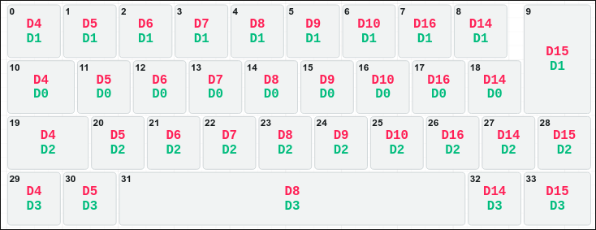

# QazIso

> [!NOTE]
> The pcb section is not finished / I probably won't complete the PCB for this project. They are just there because I made them, and maybe at somepoint someone would want to finish it. The schematic is finished if people want to look at that to base a project off of.

##Features
- 34 keys
- 6.25u spacebar
- qaz style leftmost column
- ISO key!!
- handwired (my build)
- 10.25u
- Case
    - 5° uptilt
    - 3mm thick walls
    - minimalist

Cool photos here...

[My zmk config](https://github.com/theb0b12/zmk-config-qaziso)

## Handwiring Guide

    

